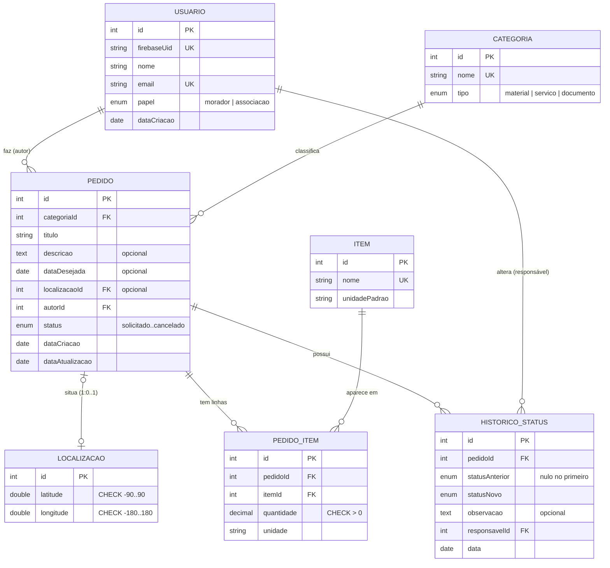

# Entidades do backend

Modelo de dados do Mutirão, com TypeORM e PostgreSQL. As regras de cada entidade, o `onDelete` justificado por regra de negócio e as restrições estão em [`docs/dominio.md`](../docs/dominio.md); o contrato das rotas está em [`docs/contrato-api.md`](../docs/contrato-api.md).

## Relacionamentos



**Pedido N-N Item** é resolvida em `PedidoItem`, porque a relação tem atributos (quantidade e unidade).

| Entidade | Arquivo | Tabela |
| --- | --- | --- |
| Usuario | `src/usuarios/usuario.entity.ts` | `usuarios` |
| Categoria | `src/categorias/categoria.entity.ts` | `categorias` |
| Item | `src/itens/item.entity.ts` | `itens` |
| Localizacao | `src/pedidos/localizacao.entity.ts` | `localizacoes` |
| Pedido | `src/pedidos/pedido.entity.ts` | `pedidos` |
| PedidoItem | `src/pedidos/pedido-item.entity.ts` | `pedido_itens` |
| HistoricoStatus | `src/pedidos/historico-status.entity.ts` | `historico_status` |

## Banco de dados e migrações

O banco é **PostgreSQL**, criado **somente por migrações** (`synchronize` desligado). Em desenvolvimento ele roda em Docker (porta 5433 do computador, para não colidir com um PostgreSQL já instalado).

```bash
docker compose up -d                  # na raiz do repositório
cp backend/.env.example backend/.env  # DATABASE_URL já aponta para o Docker
npm install                           # na raiz
npm run migration:run -w backend      # cria as tabelas num banco vazio
npm run seed -w backend               # dados de exemplo
npm run start:dev -w backend          # http://localhost:3000/api/docs
```

| Script | O que faz |
| --- | --- |
| `migration:generate -- src/migracoes/Nome` | Gera uma migração a partir da diferença entre as entidades e o banco |
| `migration:run` | Aplica as migrações pendentes |
| `migration:revert` | Desfaz a última migração |
| `seed` | Popula usuários, categorias, itens e pedidos de exemplo (pode rodar mais de uma vez) |

As migrações ficam em `src/migracoes/`.

## Testes

```bash
npm run test -w backend        # unitários: entidades, regras de status, validação (sem banco)
npm run test:e2e -w backend    # ponta a ponta contra o PostgreSQL (exige docker compose up e migration:run)
```

## Observações para quem continuar

- As propriedades de relação usam `Relation<T>`. Isso evita erro de importação circular em ESM, porque `Pedido`, `Usuario` e `PedidoItem` se referenciam.
- Os enums usam `simple-enum`, que guarda o valor como texto.
- As regras de negócio (campos por tipo de pedido, transições de status e permissões) ficam nos *services* e em `status-pedido.regras.ts`, não nos controllers nem nas entidades.
- O Windows pode bloquear os atalhos do `npm run` e do `oxlint --type-aware` em algumas máquinas (`Acesso negado`). Chamar o programa direto com `node ../node_modules/<pacote>/...` contorna o problema.
