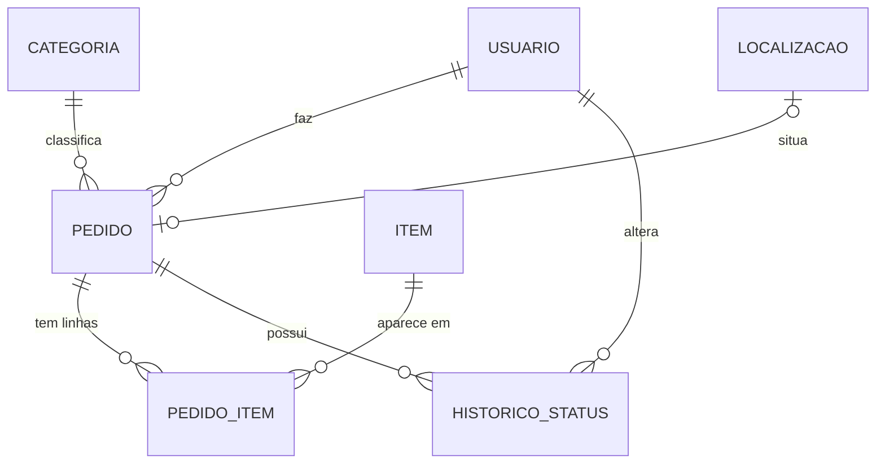

# Domínio do Mutirão

Entidades do MVP, seus atributos, relações e regras principais. Os nomes dos campos seguem o [contrato da API](contrato-api.md) e o código em `backend/src` (ver também [`backend/ENTIDADES.md`](../backend/ENTIDADES.md)).

O Mutirão registra **pedidos** que moradores e agricultores familiares fazem à Associação. Há três tipos de pedido, definidos pela categoria:

- **Material:** sementes, adubo, ferramentas e outros. O pedido lista **itens do catálogo** com a quantidade de cada um. A Associação aprova ou nega.
- **Serviço de máquina:** trator e patrol (rodagem de estrada). O serviço é da Prefeitura; a Associação **encaminha** o pedido e registra o andamento. O sistema não se integra à Prefeitura. Exige a localização.
- **Documento:** declarações que a Associação emite (ex.: de morador/residência e de convivência), assinadas pelo presidente. A Associação aprova, emite e marca como atendido quando entregue.

## Diagrama de relações

**Pedido N-N Item** é resolvida pela entidade `PedidoItem`, porque a relação tem atributos próprios (a quantidade e a unidade de cada item pedido).

## Usuario

Pessoa que acessa o sistema: morador/agricultor ou membro da Associação.

| Atributo | Tipo | Obrigatório | Observação |
| --- | --- | :---: | --- |
| id | inteiro | sim | gerado |
| firebaseUid | texto | sim | único; identificador do usuário no Firebase Auth |
| nome | texto | sim | |
| email | texto | sim | único |
| papel | `morador` \| `associacao` | sim | padrão `morador` |
| dataCriacao | data/hora | sim | gerado |

**Regras**
- A autenticação é feita pelo **Firebase Auth** (e-mail e senha, ou Google). O sistema não guarda nem recebe senhas. ⚠️ A decisão está sendo revista frente ao ADR de sessões do professor (ver `decisoes-tecnicas.md`); o login só entra na Etapa 3.
- O registro de `Usuario` é criado no primeiro acesso, a partir do token. O e-mail e o `firebaseUid` são únicos.
- Todo usuário novo é `morador`. O papel `associacao` é atribuído pela administração (T.I. da Associação).

## Categoria

Tipo de pedido. Define se o pedido é de material, de serviço de máquina ou de documento.

| Atributo | Tipo | Obrigatório | Observação |
| --- | --- | :---: | --- |
| id | inteiro | sim | gerado |
| nome | texto (até 80) | sim | único |
| tipo | `material` \| `servico` \| `documento` | sim | define as regras de preenchimento do pedido |

**Regras**
- Seed de exemplo (a confirmar com a Associação): Sementes, Adubo, Ferramentas e Outros (material); Serviço de trator e Serviço de patrol (servico); Declaração (documento).
- CRUD completo pela API. Uma categoria com pedidos não pode ser apagada nem ter o tipo alterado.

## Item

Item do catálogo do que a Associação pode atender (sementes, adubo, ferramentas...).

| Atributo | Tipo | Obrigatório | Observação |
| --- | --- | :---: | --- |
| id | inteiro | sim | gerado |
| nome | texto (até 120) | sim | único |
| unidadePadrao | texto (até 30) | sim | unidade sugerida (kg, saco, unidade...) |

**Regras**
- CRUD completo pela API. Um item que já foi pedido não pode ser apagado.

## Localizacao

Ponto geográfico da propriedade ou do trecho onde o serviço será feito.

| Atributo | Tipo | Obrigatório | Observação |
| --- | --- | :---: | --- |
| latitude | decimal | sim | entre -90 e 90 (`CHECK` no banco) |
| longitude | decimal | sim | entre -180 e 180 (`CHECK` no banco) |

**Regras**
- Pertence a um único pedido (relação 1:1) e é salva junto com ele, sem rota própria.
- **Obrigatória** em pedidos de `servico`, **opcional** em `material` e **não se aplica** a `documento`.

## Pedido

Solicitação de um morador ou agricultor à Associação.

| Atributo | Tipo | Obrigatório | Observação |
| --- | --- | :---: | --- |
| id | inteiro | sim | gerado |
| categoriaId | referência | sim | → Categoria |
| titulo | texto (até 120) | sim | resumo do pedido (ex.: "Sementes para o plantio de março", "Rodagem do ramal") |
| descricao | texto | não | detalhes; em declaração, a finalidade |
| dataDesejada | data | não | para quando precisa (AAAA-MM-DD) |
| localizacao | Localizacao | serviço: sim · material: não · documento: não se aplica | 1:0..1 |
| itens | lista de PedidoItem | material: sim (1 ou mais) · demais: não se aplica | N-N com Item |
| autorId | referência | sim | → Usuario |
| status | enum | sim | começa em `solicitado` |
| dataCriacao | data/hora | sim | gerado |
| dataAtualizacao | data/hora | sim | gerado |

**Regras**
- O autor é o usuário que faz o pedido. ⚠️ Até o login entrar (Etapa 3), a API recebe `autorId` no corpo; depois passa a vir do token.
- Morador vê apenas os próprios pedidos; Associação vê todos (a restrição entra com o login).
- O pedido só pode ser **alterado ou apagado enquanto estiver `solicitado`**; depois disso, a API responde `409`.
- O status só muda por `PATCH /pedidos/{id}/status`, seguindo as transições abaixo.
- A Associação pode qualquer mudança válida; o morador só pode **cancelar o próprio pedido**.

## PedidoItem

Uma linha do pedido: quanto de um item foi pedido.

| Atributo | Tipo | Obrigatório | Observação |
| --- | --- | :---: | --- |
| id | inteiro | sim | gerado |
| pedidoId | referência | sim | → Pedido |
| itemId | referência | sim | → Item |
| quantidade | decimal (12,2) | sim | maior que zero (`CHECK` no banco) |
| unidade | texto (até 30) | sim | se omitida na API, usa a `unidadePadrao` do item |

**Regras**
- O mesmo item não pode aparecer duas vezes no mesmo pedido (`UNIQUE (pedidoId, itemId)`).

## Status do pedido

| Status | Significado | Vale para |
| --- | --- | --- |
| `solicitado` | Estado inicial, definido ao criar | todos |
| `emAnalise` | Associação está avaliando | todos |
| `aprovado` | Associação aprovou; falta entregar o item ou emitir o documento | material, documento |
| `encaminhado` | Associação encaminhou à Prefeitura | serviço |
| `atendido` | Item entregue, serviço realizado ou declaração entregue | todos |
| `negado` | Não será atendido (exige motivo) | todos |
| `cancelado` | Cancelado pelo morador | todos |

Transições permitidas (implementadas em `backend/src/pedidos/status-pedido.regras.ts`):

| De | Para |
| --- | --- |
| `solicitado` | `emAnalise`, `negado`, `cancelado` |
| `emAnalise` | `aprovado` (material ou documento), `encaminhado` (serviço), `negado`, `cancelado` |
| `aprovado` | `atendido`, `negado` |
| `encaminhado` | `atendido`, `negado` (a Prefeitura não atendeu) |
| `atendido`, `negado`, `cancelado` | final |

## HistoricoStatus

Registro de cada mudança de status de um pedido.

| Atributo | Tipo | Obrigatório | Observação |
| --- | --- | :---: | --- |
| id | inteiro | sim | gerado |
| pedidoId | referência | sim | → Pedido |
| statusAnterior | enum | não | `null` no primeiro registro |
| statusNovo | enum | sim | |
| observacao | texto | `negado`: sim · demais: não | motivo ou nota (ex.: "Ofício enviado à Prefeitura") |
| responsavelId | referência | sim | → Usuario que fez a alteração |
| data | data/hora | sim | gerado |

**Regras**
- Criado automaticamente na criação do pedido (`null` → `solicitado`) e a cada mudança de status.
- É somente de inclusão: nunca é editado.

## Política de exclusão (`onDelete`) e justificativa

A pergunta que decide: *"este registro faz sentido sozinho?"*

| Relação | `onDelete` | Justificativa de negócio |
| --- | --- | --- |
| Pedido → Categoria | `RESTRICT` | Um pedido já feito continua existindo no mundo; apagar a categoria faria o histórico da Associação perder o contexto do que foi pedido. Erro alto é melhor que perda silenciosa. |
| Pedido → Usuario (autor) | `RESTRICT` | O pedido registra quem pediu o quê. Sem o autor, a Associação perde a prestação de contas. |
| Pedido → Localizacao | `SET NULL` | A localização pertence ao pedido; se for removida, o pedido continua válido (a API a apaga junto com o pedido). |
| PedidoItem → Pedido | `CASCADE` | Uma linha de pedido não faz sentido sem o pedido ("20 kg de nada"). |
| PedidoItem → Item | `RESTRICT` | Um item usado em pedidos já feitos não pode sumir do catálogo, ou o pedido perderia o significado. |
| HistoricoStatus → Pedido | `CASCADE` | O histórico descreve o pedido; sem ele não há o que contar. Na prática pedidos só são apagados enquanto `solicitado`. |
| HistoricoStatus → Usuario (responsável) | `RESTRICT` | Quem alterou um status é parte da prestação de contas e não pode desaparecer. |

## Restrições de integridade no banco

| Restrição | Regra de negócio |
| --- | --- |
| `UNIQUE (email)` e `UNIQUE (firebaseUid)` | Uma pessoa, uma conta |
| `UNIQUE (nome)` em Categoria e em Item | Sem duplicidade no catálogo |
| `UNIQUE (pedidoId, itemId)` | O mesmo item não repete no mesmo pedido |
| `CHECK (quantidade > 0)` | Não existe pedido de zero ou de quantidade negativa |
| `CHECK` de latitude (-90 a 90) e de longitude (-180 a 180) | Localização que existe no planeta |

## Resumo das relações

| Relação | Cardinalidade |
| --- | --- |
| Usuario → Pedido | 1 usuário faz N pedidos |
| Categoria → Pedido | 1 categoria classifica N pedidos |
| Pedido ↔ Localizacao | 1:0..1 (obrigatória em serviço) |
| **Pedido ↔ Item** | **N-N**, resolvida em `PedidoItem` (com quantidade e unidade) |
| Pedido → HistoricoStatus | 1 pedido possui N registros de histórico |
| Usuario → HistoricoStatus | 1 usuário faz N alterações |
